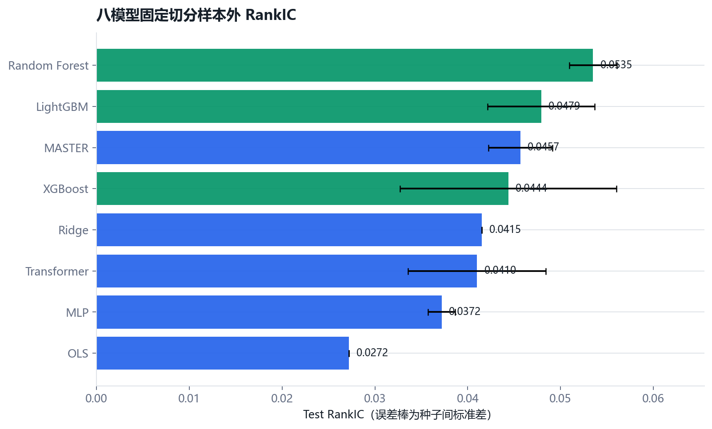
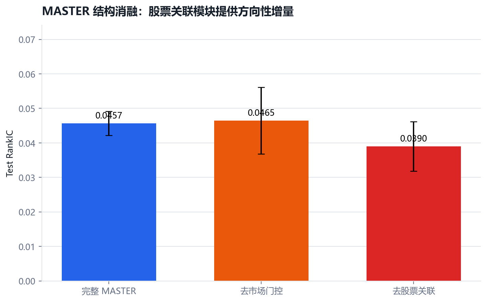
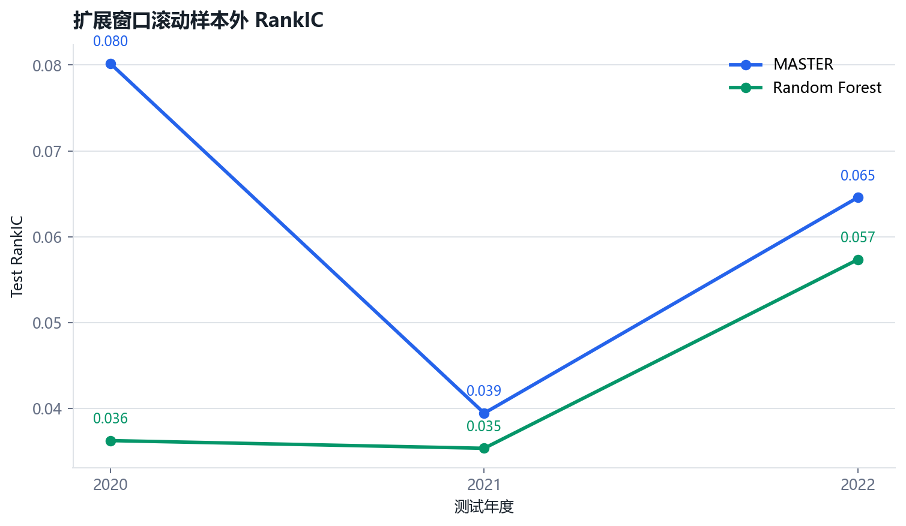
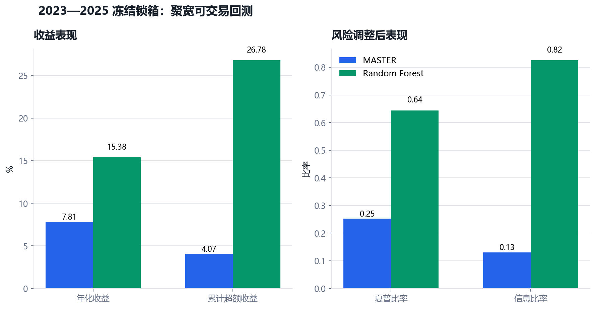

# 市场感知与多股票关联的机器学习选股策略

> 参考 AAAI 2024 MASTER，在时点正确的A股数据上完成八模型强基线、结构与特征消融、滚动样本外、市场状态分析、真实交易约束以及2023—2025冻结锁箱检验。



## 项目定位

本项目以 AAAI 2024 论文《MASTER: Market-Guided Stock Transformer for Stock Price Forecasting》为方法参考，在自建的 A 股日频、时点正确数据上研究未来收益的横截面排序预测。

项目不是简单复刻论文指标，也不是罗列若干机器学习模型。研究主线是：

> 先建立可审计的数据与强基线，再检验时间序列建模、股票间动态关系和市场状态引导能否提供稳定的样本外增量，最后判断这种预测增量在真实交易约束和成本下是否仍有经济价值。

## 项目亮点

- **完整研究闭环**：从数据时点审计、特征标签、模型训练、统计检验和可执行回测，一直推进到冻结锁箱，而非停留在训练集分数。
- **强基线公平比较**：统一信息集下比较8类模型，Random Forest 最终胜出，避免用弱基线衬托深度模型。
- **拆解MASTER而非黑箱复现**：分别检验市场门控、股票间聚合和特征组的真实增量。
- **多层样本外证据**：三随机种子、扩展窗口滚动训练、年度与市场状态分段、Newey-West配对检验和区块自助法。
- **预测与交易严格分开**：同时报告RankIC和次日开盘、不可交易约束、成本后的组合结果。
- **一次性冻结锁箱**：2022年底冻结规则，2023—2025只测试一次，并保留复杂模型未胜出的诚实结论。

## 核心研究问题

1. 线性模型和梯度提升树能在 A 股日频数据上取得怎样的样本外预测能力？
2. 序列模型是否提供超出静态截面模型的增量？
3. MASTER 的市场引导门控和股票间动态信息聚合是否具有独立贡献？
4. 模型增益能否跨市场阶段、跨股票池保持稳定，并覆盖交易成本？
5. 如果复杂模型没有战胜 LightGBM，它失败在预测、换手、市场漂移还是模型估计不稳定？

## 研究对象

- 主任务：在交易日收盘后，预测股票未来 5 个交易日收益的横截面排序。
- 主股票池：使用历史成分股口径的沪深300；中证800作为扩展验证。
- 主特征：Alpha158 日频量价特征、市场状态特征，以及项目二中已验证量价因子的独立增量组。
- 主模型：OLS、Ridge、LightGBM、三层 PyTorch MLP、vanilla Transformer、MASTER。
- 主评估：RankIC、RankICIR、分组收益、Top-K 组合收益、信息比率、最大回撤、换手率和成本后收益。

## 两层实验设计

### 第一层：论文对齐实验

尽量对齐论文的股票池、Alpha158、8日回看窗口、5日预测区间、截面标准化标签和 Top-30 组合，验证实现是否合理。由于数据源和成分股历史可能不同，本项目不承诺逐项复现论文数值。

### 第二层：独立扩展实验

采用滚动样本外训练、标签区间隔离、下一交易日成交、真实交易成本及可交易性约束，并在论文发表后的数据上进行冻结测试。这一层才是项目最终研究结论的主要依据。

## 项目成立的标准

项目成功不等于“MASTER 必须收益最高”。满足以下条件即可形成可信研究成果：

- 数据、标签和切分不存在已知未来信息泄漏；
- 所有模型使用同一股票池、特征口径和调参预算进行公平比较；
- 至少完成强基线、vanilla Transformer 与 MASTER 的滚动样本外比较；
- 预测指标和含成本组合指标均可复算，并报告不同市场阶段结果；
- 通过消融实验说明复杂模块是否真正提供增量；
- 如复杂模型失效，能够定位原因并如实报告，而不是反复修改测试集直到得到正结果。

执行顺序和每阶段验收要求见 [WORKFLOW.md](WORKFLOW.md)；完整研究协议和研究边界见 [docs/research_protocol.md](docs/research_protocol.md)。

## 当前主要发现

- 论文对齐固定切分下，RandomForest 的三种子 Test RankIC 为 `0.0535 ± 0.0026`，是整体最稳健模型；MASTER 为神经网络中最好，Test RankIC 为 `0.0457 ± 0.0034`。
- MASTER 去掉股票间聚合后 Test RankIC 降至 `0.0390 ± 0.0072`，支持股票间关系建模存在方向性增量；去掉市场门控未降低平均RankIC，但种子间波动明显扩大。
- 项目二量价因子 F1-only 的 Test RankIC 为 `0.0483 ± 0.0034`，高于 Alpha158-only 的 `0.0360 ± 0.0074`；F1 对 Alpha158 存在边际增量，但简单拼接并未超过 F1-only。
- 三折扩展窗口中，MASTER 在2020/2021/2022年均高于 RandomForest，平均 Test RankIC 为 `0.0614` 对 `0.0430`；但优势主要来自2020年，逐日配对 Newey–West t值约 `1.95`，不作“稳定显著战胜”的夸张表述。
- 在完全相同的606个交易日上，年度滚动使 MASTER RankIC 相对一次固定训练提高约 `0.0116`，却使 RandomForest 下降约 `0.0079`；滚动更新的价值依赖模型与市场阶段。
- 市场状态分段显示，滚动 MASTER 相对 RandomForest 的优势集中在上涨低波动阶段（RankIC差约 `+0.0339`，NW t=`2.47`）；上涨高波动阶段差值为负，复杂模型的价值具有明显状态依赖。
- 固定切分下，MASTER 相对 Transformer 的日均 RankIC 增量约 `+0.0047`，但配对 NW t仅 `0.87`；去股票间聚合的损失约 `0.0067`，NW t=`1.11`，均只作方向性证据。
- Top-K、成本和持有期敏感性表明组合结果对交易摩擦高度敏感；因此锁箱继续使用预先规定的Top-30、5日持有和真实成本，不根据稳健性结果重新挑选参数。
- 论文对齐预测能力在 `t+1` 开盘成交、停牌涨跌停与成本约束下明显衰减，因此预测指标和可交易收益严格分开报告。
- 2023—2025 冻结锁箱期内，MASTER 的日度 RankIC 均值略高于 RandomForest，但配对差异不显著（Newey–West t=`1.061`，区块自助法95%置信区间为 `[-0.0103, 0.0284]`）。
- 相同冻结组合规则下，聚宽可交易回测中 RandomForest 累计收益为 `51.61%`、年化收益为 `15.38%`、信息比率为 `0.825`；MASTER 分别为 `24.45%`、`7.81%` 和 `0.130`。预测层排序优势没有转化为更好的组合表现。

G9 锁箱协议见 [docs/g9_freeze.md](docs/g9_freeze.md)，统计检验与聚宽回测结论见 [docs/g9_lockbox_results.md](docs/g9_lockbox_results.md)，原始截图和机器可读汇总见 [results/g9_lockbox](results/g9_lockbox)。

## 核心结果图

| MASTER结构消融 | 滚动样本外 |
|---|---|
|  |  |



## 项目结构

```text
configs/    冻结的研究、数据和G9锁箱配置
cloud/      云端GPU训练与年度滚动/锁箱入口
docs/       数据口径、冻结协议、模型结果与完整研究报告
results/    可提交的机器可读结果、正式图表和聚宽证据
src/        数据准备、模型、回测、统计检验与制图代码
tests/      关键时间逻辑和数据处理测试
```

## 阅读顺序

1. [完整研究报告](docs/research_report.md)
2. [模型与消融结果](docs/model_results.md)
3. [G9冻结锁箱结果](docs/g9_lockbox_results.md)
4. [完整执行工作流](WORKFLOW.md)
5. [数据清单与口径](docs/data_manifest.md)

## 最小复现

以下命令均从项目根目录执行。原始大数据和缓存不进入Git；模型结果表、图表和冻结配置保留在仓库中。

```bash
# 安装研究与验收依赖（JQData需在聚宽环境单独使用）
python -m pip install -r requirements.txt

# 重新生成正式结果图（不训练、不改参数）
python src/plot_research_summary.py

# 运行关键测试
python -m pytest tests -q

# 查看锁箱机器可读结果
python -c "import pandas as pd; print(pd.read_csv('results/g9_lockbox/joinquant_summary.csv'))"
```

完整训练、滚动样本外和锁箱执行顺序见 [WORKFLOW.md](WORKFLOW.md)，云端入口见 [cloud/README.md](cloud/README.md)。

## 结论边界

本项目支持“股票间关系建模具有方向性价值、复杂模型效果具有市场状态依赖”，但不支持“MASTER稳定显著战胜所有基线”。最终冻结可交易回测中 Random Forest 明显优于 MASTER。所有结果均为历史研究，不构成投资建议。

## 当前状态

- [x] 确定研究方向与参考论文
- [x] 完成研究全链路设计
- [x] 完成主样本数据可得性审计与训练面板
- [x] 完成 OLS、Ridge 和三类树模型基线
- [x] 完成 MLP、Transformer 与 MASTER 三随机种子训练
- [x] 完成论文对齐与真实可执行两套组合回测
- [x] 完成 MASTER 去市场门控、去股票间聚合核心消融
- [x] 完成 Alpha158、项目二因子及二者组合的特征消融
- [x] 完成 RandomForest/MASTER 三折扩展窗口滚动训练
- [x] 完成市场状态、Top-K、成本和持有期稳健性检验
- [x] 完成主模型及消融的RankICIR与日度配对检验
- [x] 冻结G9锁箱规则
- [x] 完成2023—2025冻结区间一次性锁箱测试
- [x] 完成相同规则下的聚宽MASTER/RandomForest可交易回测
- [x] 保存锁箱统计表、聚宽汇总和原始结果截图
- [ ] 整理正式结果、图表与研究报告

