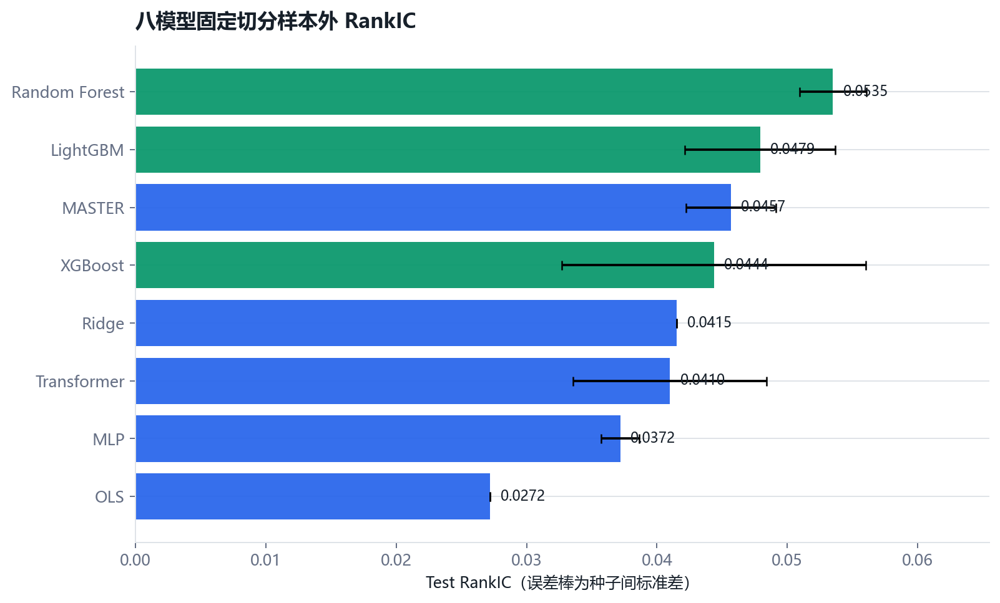
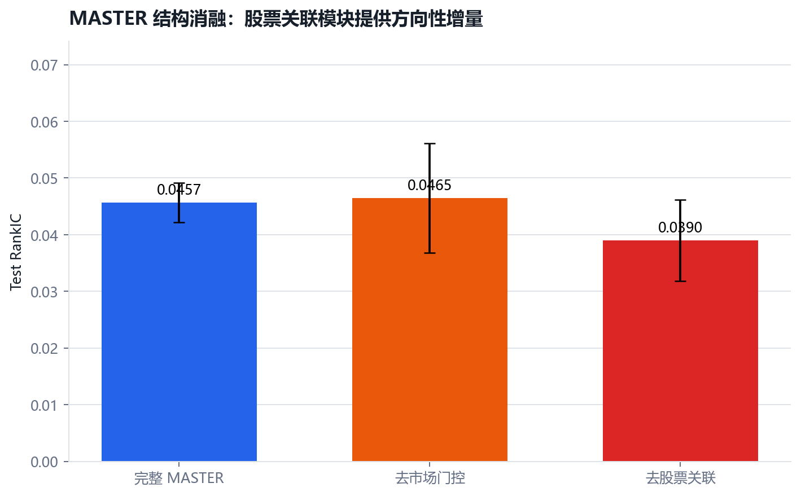
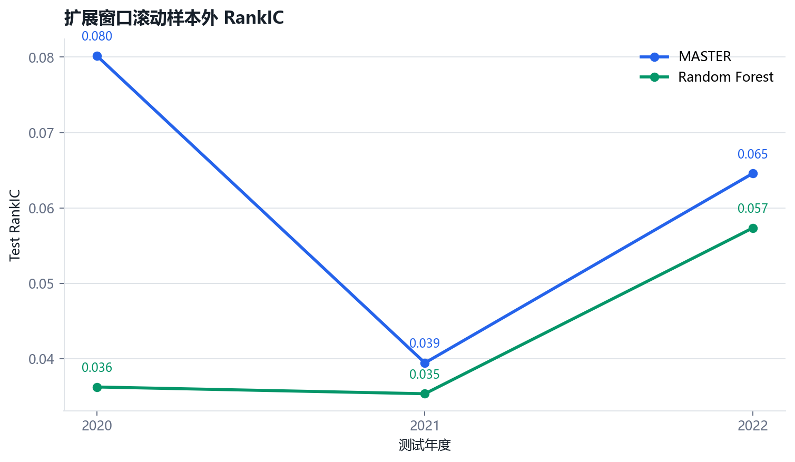
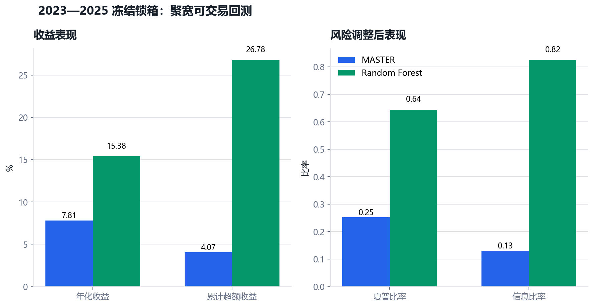

# 市场感知与多股票关联的机器学习选股策略

## 摘要

本项目以 AAAI 2024 的 MASTER（Market-Guided Stock Transformer）为方法参考，在自建的A股时点正确数据上，检验市场状态引导和股票间动态关系建模能否带来稳定、可交易的横截面收益预测增量。研究不是单次训练结果展示，而是从数据审计、强基线、公平比较、结构与特征消融、滚动样本外、市场状态分解、真实执行回测，一直推进到2023—2025冻结锁箱检验。

核心发现是：Random Forest 在固定切分和最终可交易锁箱中最稳健；MASTER 是表现最好的神经网络，并且股票间关系聚合具有方向性增量，但其预测优势具有明显市场状态依赖，且未在最终锁箱中转化为优于 Random Forest 的组合收益。该结果说明，模型复杂度、预测排序能力与真实经济价值之间不能画等号。

## 研究问题

1. MASTER 相比线性模型、树模型、MLP 与普通 Transformer 是否存在稳定样本外增量？
2. 市场门控与股票间关系聚合分别贡献了什么？
3. 增量能否跨随机种子、年度和市场状态保持？
4. 论文口径预测能力在次日成交、不可交易约束和成本后是否仍具经济价值？
5. 在完全冻结规则后，2023—2025锁箱期能否支持锁箱前结论？

## 方法与实验纪律

- 任务：收盘后预测未来5个交易日收益的横截面排序。
- 股票池：历史成分口径的沪深300；中证800作为扩展方向。
- 信息集：Alpha158、项目二量价因子与市场状态特征。
- 模型阶梯：OLS、Ridge、LightGBM、XGBoost、Random Forest、MLP、Transformer、MASTER。
- 时间纪律：训练、验证和测试按完整日期切分；标准化器仅拟合训练集；标签区间设置隔离。
- 稳健性：三随机种子、扩展窗口滚动训练、市场状态分段、RankICIR、Newey-West配对检验与区块自助法。
- 交易纪律：论文对齐回测和真实可执行回测分开；锁箱组合固定为Top 30、每5个信号日调仓、下一交易日开盘执行。
- 锁箱纪律：2022-12-30前冻结全部规则，2023—2025只开启一次，不按结果回调参数。

## 主要结果

### 1. 强基线比较

固定切分三种子结果中，Random Forest 的 Test RankIC 为 `0.0535 ± 0.0026`，整体最稳健；MASTER 为 `0.0457 ± 0.0034`，是神经网络中表现最好的模型。复杂模型没有天然战胜树模型。

### 2. MASTER结构消融

去除股票间聚合后，MASTER Test RankIC 从 `0.0457` 降至 `0.0390`，方向上支持跨股票关系建模有价值；但配对检验未达到强显著。去除市场门控没有降低平均RankIC，却明显增加种子间波动，因此门控更可能改善估计稳定性，而非稳定提高均值。

### 3. 滚动样本外与状态依赖

2020—2022三折扩展窗口中，MASTER 的平均 RankIC 为 `0.0614`，Random Forest 为 `0.0430`，三个年度方向一致；但差异主要来自2020年。进一步分段显示，MASTER 的优势集中在上涨低波动阶段，在上涨高波动阶段反而没有优势。

### 4. 冻结锁箱与真实组合

2023—2025锁箱期内，MASTER 的平均日度 RankIC 略高于 Random Forest，但配对差异不显著（Newey-West t=`1.061`；区块自助法95%置信区间 `[-0.0103, 0.0284]`）。在完全相同的聚宽组合规则下，Random Forest 累计收益为 `51.61%`、年化收益 `15.38%`、信息比率 `0.825`；MASTER 分别为 `24.45%`、`7.81%` 和 `0.130`。

这不是“复杂模型失败所以删掉结果”，而是项目最重要的实证发现：轻微且不显著的平均排序优势，并不保证更好的尾部预测、持仓结构和成本后组合收益。

## 研究贡献

1. 将 MASTER 从论文模型扩展为一条可审计的A股研究链路，而非只复现单个指标。
2. 使用八模型强基线和统一信息集，避免用弱基线制造复杂模型优势。
3. 通过结构、特征、随机种子、滚动窗口和市场状态多层消融定位增量来源。
4. 严格区分论文对齐、真实可执行和冻结锁箱三类证据，减少研究者自由度。
5. 如实保留 Random Forest 最终胜出的结果，并解释预测指标与交易绩效之间的断层。

## 局限

- 数据源、历史成分股与论文官方数据不完全一致，因此不主张逐项复现论文数值。
- 市场状态门控的平均预测增量尚无稳定统计支持。
- 锁箱仅覆盖2023—2025，2025年两个模型均出现预测衰减，跨周期外推仍需谨慎。
- 当前组合是冻结的研究组合，不构成投资建议，也未覆盖冲击成本、容量和实时撮合的全部细节。

## 证据与复现入口

- 完整数值：[模型结果记录](model_results.md)
- G9协议：[冻结说明](g9_freeze.md)
- G9结果：[锁箱报告](g9_lockbox_results.md)
- 机器可读结果：[`results/`](../results)
- 全流程定义：[`WORKFLOW.md`](../WORKFLOW.md)
- 数据口径：[`data_manifest.md`](data_manifest.md)
